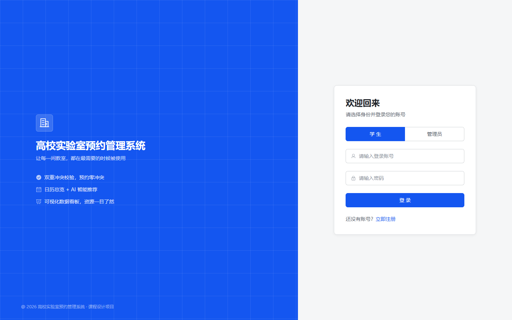
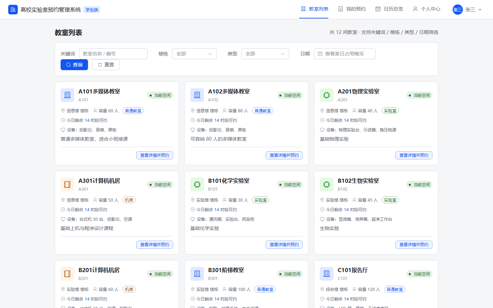
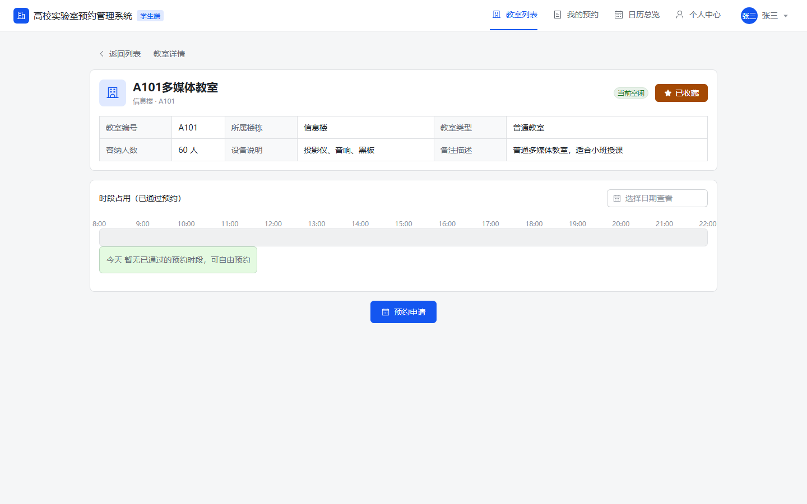
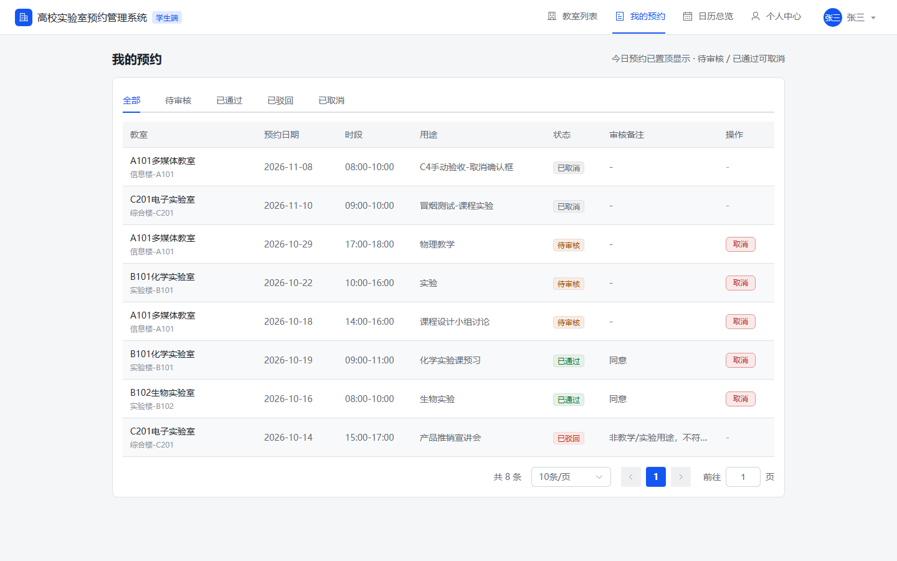
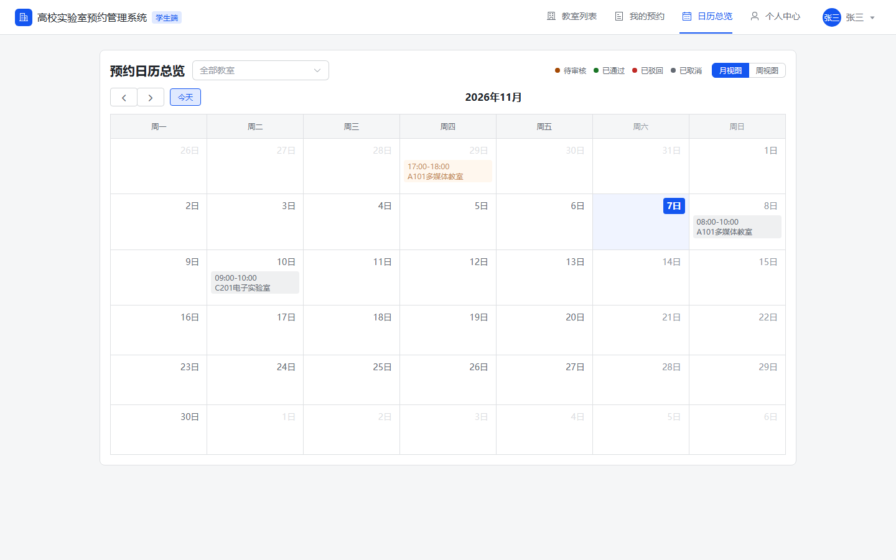
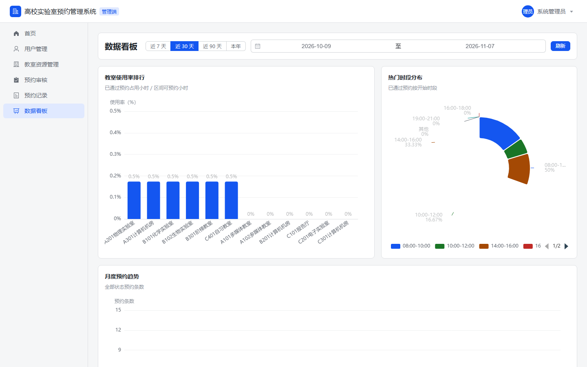
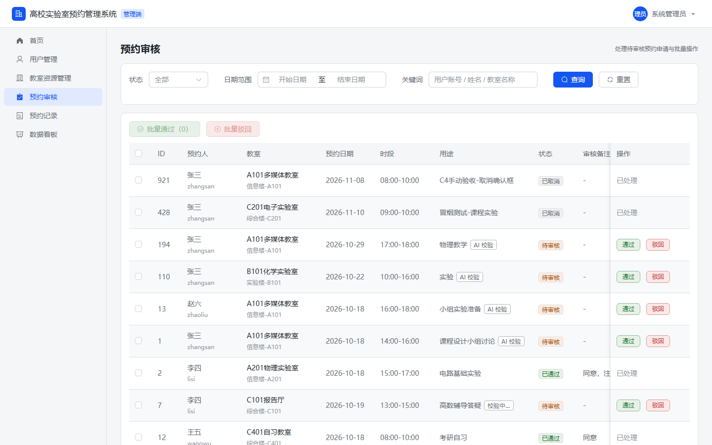
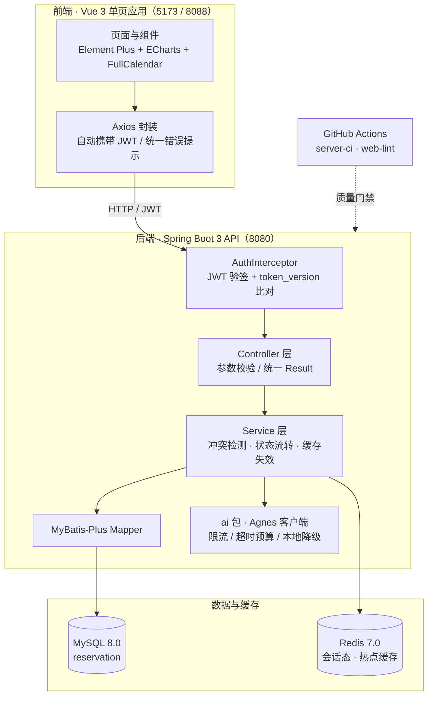

# 高校实验室预约管理系统

[](https://github.com/Alexander-cloud123/lab-reservation-system/actions/workflows/web-lint.yml)
[](https://github.com/Alexander-cloud123/lab-reservation-system/actions/workflows/server-ci.yml)
[](https://github.com/Alexander-cloud123/lab-reservation-system/actions/workflows/stack-smoke.yml)
[](LICENSE)


前后端分离的高校实验室/教室预约管理系统，覆盖 R1–R13 共 13 轮完整迭代。核心特点是**预约提交的「前端实时校验 + 后端二次冲突检测」双重校验机制**，以及**严格的预约状态流转**：

- 冲突检测公式：`新开始 < 旧结束 AND 新结束 > 旧开始`
- 状态流转：待审核(0) → 已通过(1) / 已驳回(2)；待审核 / 已通过 → 已取消(3)

## 项目预览

截图来自本机真实运行（种子账号登录，1440×900），可用 `node web/scripts/capture-screens.mjs` 复现：

<table>
  <tr>
    <td></td>
    <td></td>
  </tr>
  <tr>
    <td align="center">登录（角色切换 + 字段级错误提示）</td>
    <td align="center">教室列表（关键词 / 楼栋 / 类型 / 日期筛选）</td>
  </tr>
  <tr>
    <td></td>
    <td></td>
  </tr>
  <tr>
    <td align="center">教室详情（预约申请与实时冲突检测）</td>
    <td align="center">我的预约（今日置顶 + 状态筛选 + 取消）</td>
  </tr>
  <tr>
    <td></td>
    <td></td>
  </tr>
  <tr>
    <td align="center">日历总览（FullCalendar 月 / 周视图）</td>
    <td align="center">数据看板（使用率排行 / 时段分布 / 趋势）</td>
  </tr>
  <tr>
    <td></td>
    <td></td>
  </tr>
  <tr>
    <td align="center">预约审核（单条审核 + 批量通过 / 驳回）</td>
    <td></td>
  </tr>
</table>

## 核心功能

| 模块 | 能力 |
|------|------|
| 账号与权限 | 登录注册、JWT 鉴权、学生 / 管理员双角色权限拦截 |
| 教室管理 | 教室增删改查、按楼栋与条件筛选、启用停用 |
| 预约核心 | 教室浏览与详情、预约提交（双重校验）、时段冲突检测、管理员审核 |
| 个人中心 | 资料维护、收藏全链路、预约记录查询 |
| 亮点功能 | 日历总览（FullCalendar）、数据看板（ECharts） |
| 数据导出 | 预约记录 Excel 导出（EasyExcel） |
| AI 能力 | 智能推荐、自然语言预约解析、智能问答、合规校验（可一键关闭，关闭不影响核心系统） |

## 技术栈

| 端 | 技术 |
|----|------|
| 后端 | Spring Boot 3.2.10 · MyBatis-Plus 3.5.7 · Knife4j 4.4.0 · EasyExcel 3.3.4 · Hutool 5.8.32 · spring-webflux（仅用 WebClient）· Spring Data Redis · JDK 21（统一 `jakarta.*`） |
| 前端 | Vue 3.4.38 · Vite 5 · Element Plus 2.7.8 · Pinia 2.1.7 · Vue Router 4.4.3 · ECharts 5.5.1 · FullCalendar 6.1.15 · day.js 1.11.13 · markdown-it · dompurify |
| 数据库 | MySQL 8.0（容器 `reservation-mysql`，库名 `reservation`，utf8mb4） |
| 缓存 | Redis 7.0（容器 `reservation-redis`，Token 校验与热点数据缓存，可一键启停） |
| AI 服务 | Agnes AI（国内节点 `https://api.agnes-ai.cn/v1`，模型 `agnes-3.0-flash`，密钥仅经环境变量注入，超时 60 秒自动降级为本地规则） |
| 测试 | JUnit 5 + Mockito（后端单测）· ESLint 9 + Prettier 3（前端规范）· Playwright 1.63（E2E） |

后端严格遵循 `controller → service → mapper → entity` 四层结构，所有接口统一返回 `Result`，并实现全局异常处理器，不向前端暴露异常堆栈。

## 架构设计



关键取舍（面试常被追问的三点）：

| 设计点 | 方案 | 原因 |
|--------|------|------|
| 会话撤销 | `sys_user.token_version` 版本号 + JWT 携带比对，Redis 仅做 60 秒缓存 | 登出 / 改密 / 禁用必须**服务端持久生效**；纯 Redis 黑名单在 Redis 关闭或抖动时失效，且无法证明“无 Redis 也能撤销” |
| 冲突检测 | 前端实时校验 + 后端 `新开始 < 旧结束 AND 新结束 > 旧开始` 二次检测，条件更新 + `FOR UPDATE` | 前端校验只做体验，并发正确性必须由数据库条件更新兜底，避免“先查后写”竞态 |
| AI 降级 | 超时 60 秒 / 429 / 报错一律降级为本地规则模拟；`ai.enable` + `ai_config.ai_enable` 双开关 | AI 是加分项而非依赖项，任何情况都不能阻断预约主流程；双开关保证默认关闭时零外部依赖 |

## 目录结构

```
lab-reservation-system/
├── server/                       # 后端工程（Spring Boot 3.2.10，唯一代码源）
│   ├── src/main/java/            # 分层代码 + ai 独立包
│   ├── src/test/java/            # 单元测试与并发集成测试
│   └── scripts/                  # smoke.ps1（接口冒烟 41 项）/ ai-real-acceptance.ps1（真实模型验收）/ a11y-acceptance.mjs（无障碍机器代理）
├── web/                          # 前端工程（Vue 3.4 + Vite 5，唯一代码源）
│   ├── src/                      # 页面 / 组件 / 路由 / 接口封装
│   ├── scripts/                  # capture-screens.mjs（README 预览截图采集）/ a11y-acceptance.mjs
│   └── e2e/                      # Playwright E2E（specs + helpers）
├── database/init_db.sql          # 建库建表 + 基线数据（自包含，可重复执行）
├── database/migrations/          # 存量库增量迁移（token_version 会话撤销列）
├── materials/                    # 答辩 PPT 与实训报告
├── docs/
│   ├── iterations/R1~R13/        # 各轮 任务说明 / 接口清单 / 测试报告 / 启动说明
│   ├── qa/                       # QA 收口报告
│   ├── review/                   # 软件审查报告与可视化
│   ├── e2e/                      # 端到端测试报告与回归脚本
│   └── images/                   # README 预览截图（真实运行采集）
├── .agents/skills/               # 项目级前端设计技能（frontend-design / avoid-ai-design / web-design-guidelines）
├── .github/
│   ├── workflows/                # web-lint.yml（前端 lint+build）/ server-ci.yml（后端构建与单测）
│   └── PULL_REQUEST_TEMPLATE.md
├── AGENTS.md                     # 协作章程与红线约束
├── CHANGELOG.md                  # 版本与迭代变更记录
├── CONTRIBUTING.md               # 贡献指南（环境基线 / 提交规范 / 入库纪律）
├── LICENSE                       # 版权声明
├── docker-compose.yml            # MySQL / Redis / 后端 api / 前端 web 编排
├── spec.md                       # 技术开发规格书
└── 需求设计文档.md               # 业务需求与设计依据（唯一需求基准，V3.1）
```

## 快速开始

环境要求：Docker（仅容器方式）；本地开发另需 JDK 21 LTS · Maven 3.9.x · Node.js 22.x。

### 方式一：容器一键启动（数据库 / 缓存 / 后端 / 前端全在 Docker 内）

```powershell
# 1. 准备环境变量（可选；不建 .env 时使用默认值：Web 8088、API 8080、AI 关闭）
Copy-Item .env.example .env

# 2. 首次执行：MySQL 数据卷为外部卷，需先创建
docker volume create reservation-mysql-data

# 3. 构建并启动四条服务（首次构建需拉取依赖镜像，耗时较长）
docker compose up -d --build
docker compose ps                             # 四条服务均应为 healthy

# 4. 访问
#    系统入口   http://localhost:8088
#    接口文档   http://localhost:8080/doc.html
```

数据库首次初始化由容器自动执行 [init_db.sql](database/init_db.sql)（仅在数据卷为空时触发，不会覆盖已有数据）；若已有历史数据卷，数据原样保留。

> **已有数据卷需要执行一次迁移**：会话撤销依赖 `sys_user.token_version` 列，`init_db.sql` 只在空库执行，存量库请跑幂等迁移脚本（重复执行安全）：
> ```powershell
> docker compose exec -T mysql mysql -uroot -proot --default-character-set=utf8mb4 < database/migrations/20261107_add_sys_user_token_version.sql
> ```
> 升级后所有**升级前签发的 Token 立即失效**（新 Token 必须携带版本号），重新登录即可。

启用 AI（可选，双开关缺一不可）：

```powershell
# 1. .env 中设置 AI_ENABLE=true 与 AGNES_API_KEY=<你的密钥>，然后重建后端使环境变量生效
docker compose up -d api

# 2. 打开数据库动态开关（数据卷首次初始化后 ai_enable 基线为 false，必须手动置 true）
docker compose exec mysql mysql -uroot -proot -e "UPDATE reservation.ai_config SET config_value='true' WHERE config_key='ai_enable';"

# 3. 前端重新登录，AI 入口才会出现（登录接口下发 aiEnabled，前端落盘 localStorage）
```

> 注意：`docker compose down -v`、删除数据卷或数据目录为空导致重新执行 init 后，`ai_config.ai_enable` 会回到 `false`，需重跑第 2 步；仅重启容器不受影响。

### 方式二：本地开发（后端 / 前端跑在宿主机，数据库与缓存用容器）

```powershell
# 1. 启动数据库与缓存（容器名 reservation-mysql:3307 / reservation-redis:6380）
docker volume create reservation-mysql-data   # 首次执行：该数据卷为外部卷
docker compose up -d mysql redis
docker compose ps                             # 查看健康状态

# 2. 初始化数据库（仅需一次；脚本自包含 DROP+CREATE+INSERT，可重复执行）
mysql -h 127.0.0.1 -P 3307 -uroot -proot < database/init_db.sql
#    已有历史库（不是全新建库）时，额外执行一次幂等迁移（token_version 会话撤销列）
mysql -h 127.0.0.1 -P 3307 -uroot -proot < database/migrations/20261107_add_sys_user_token_version.sql

# 3. 启动后端（端口 8080，接口文档 http://localhost:8080/doc.html）
#    注意：容器映射端口为 3307/6380，与配置默认值 3306/6379 不同，必须先注入环境变量
$env:MYSQL_URL      = "jdbc:mysql://localhost:3307/reservation?useUnicode=true&characterEncoding=utf8&serverTimezone=Asia/Shanghai"
$env:MYSQL_USERNAME = "root"
$env:MYSQL_PASSWORD = "root"
$env:REDIS_PORT     = "6380"
mvn -f server/pom.xml spring-boot:run

# 4. 启动前端（端口 5173，/api 自动代理到后端 8080）
cd web
npm ci
npm run dev                                   # 浏览器访问 http://127.0.0.1:5173
```

演示账号：管理员 `admin / admin123`；学生 `zhangsan / 123456`（另有 `lisi`、`wangwu`、`zhaoliu`，密码均为 `123456`）。

## 环境变量

后端配置采用 `${ENV:default}` 占位写法，全部可在不改动配置文件的条件下覆盖（来源：[application.yml](server/src/main/resources/application.yml)）。

| 变量 | 默认值 | 用途 | 是否必填 |
|------|--------|------|----------|
| `MYSQL_URL` | `jdbc:mysql://localhost:3306/reservation?...` | 数据库连接串 | 本机容器映射 3307，需覆盖 |
| `MYSQL_USERNAME` | `root` | 数据库账号 | 否 |
| `MYSQL_PASSWORD` | `root` | 数据库密码 | 否 |
| `REDIS_HOST` | `127.0.0.1` | Redis 主机 | 否 |
| `REDIS_PORT` | `6379` | Redis 端口 | 本机容器映射 6380，需覆盖 |
| `REDIS_PASSWORD` | 空 | Redis 密码 | 否 |
| `REDIS_DATABASE` | `0` | Redis 库序号 | 否 |
| `REDIS_ENABLE` | `true` | Redis 总开关；置 `false` 后无单点会话、无缓存（登出 / 改密等撤销仍由 `token_version` 生效），启用但连接异常时会话校验 fail closed（401） | 否 |
| `MYBATIS_LOG_IMPL` | `org.apache.ibatis.logging.stdout.StdOutImpl` | SQL 日志实现，置 `nologging` 可关闭 | 否 |
| `KNIFE4J_ENABLE` | `true` | 接口文档开关 | 否 |
| `AI_ENABLE` | `false` | AI 静态总开关 | 否 |
| `AGNES_API_KEY` | 空 | AI 密钥，**仅环境变量注入，禁止硬编码**；启用 AI 时必填 | 启用 AI 时必填 |
| `JWT_SECRET` | 本地开发默认值 | Token 签名密钥，**生产/演示环境必须覆盖** | 生产环境必填 |

前端与 E2E 侧变量（来源：[vite.config.js](web/vite.config.js)、[playwright.config.js](web/playwright.config.js)）：

| 变量 | 默认值 | 用途 |
|------|--------|------|
| `VITE_API_TARGET` | `http://localhost:8080` | Vite 开发代理的后端目标 |
| `E2E_API_PORT` | `8080` | E2E 后端端口（同时作为前端代理目标） |
| `E2E_API_BASE` | `http://127.0.0.1:${E2E_API_PORT}` | E2E 启动探活地址 |
| `E2E_API_TARGET` | `http://localhost:${E2E_API_PORT}` | E2E 期间的后端代理目标 |
| `E2E_WEB_PORT` | `5173` | E2E 前端端口 |

## AI 模块

**双开关，默认关闭**，关闭后不影响核心系统运行：

- 静态总开关：`application.yml` 中 `ai.enable`（默认 `false`，可被环境变量 `AI_ENABLE` 覆盖）。
- 数据库开关：`ai_config` 表的 `ai_enable`。两者同为 `true` 时 AI 功能可用。

> 容器化启动时数据库开关需手动打开：`init_db.sql` 基线为 `false`，重建数据卷后会再次关闭。具体命令见「快速开始 · 方式一」的**启用 AI**一节。

运行时行为：

- 接入国内节点 `https://api.agnes-ai.cn/v1`，模型 `agnes-3.0-flash`，密钥经 `AGNES_API_KEY` 注入，前端零接触。
- 读取超时 60 秒；超时、报错或触发限流时自动降级为**本地规则模拟模式**，功能完整可演示，不阻断业务。
- **只读不写**：AI 仅查询数据、解析需求、给出建议，所有业务操作必须由用户手动确认；生成内容前端统一标注「AI 生成，仅供参考」。

流式契约（R12 / R13）：

- 智能问答 `POST /api/ai/chat?stream=true` 为真流式输出（打字机体验），支持 Markdown 渲染、会话内多轮上下文（不持久化）、发送中停止生成。
- 推荐 / 预约解析 / 合规校验三个接口在 `?stream=true` 时输出结构化进度事件流 `meta → phase → result → done`，其中 `result` 与非流式的 `data` 完全同构。
- 不带 `?stream=true` 时，全部接口保持原有 `Result<VO>` 契约不变。

## 测试

| 层次 | 规模 | 入口 |
|------|------|------|
| 后端单元 / 集成测试 | 36 个测试类、262 个用例（含真实 MySQL + Redis 的 `@SpringBootTest` 与并发集成测试） | `mvn -f server/pom.xml test` |
| 接口冒烟回归 | 41 项（鉴权 / 权限 / 预约生命周期 / 冲突检测 / 参数校验 / 看板 / 收藏 / AI 降级 / 会话撤销） | `pwsh server/scripts/smoke.ps1` |
| 前端 E2E | 17 个 spec、120 个用例 × Chromium + Edge | `npm run test:e2e:all` |
| 无障碍机器代理 | 16/16 项（人工听感按负责人决定不执行） | `node scripts/a11y-acceptance.mjs` |

```powershell
# 后端单元测试（36 个测试类；其中 4 个 @SpringBootTest 需 MySQL 在线，3 个另需 Redis；
# TokenRevocationIntegrationTest 固定 redis.enable=false，用于证明“没有 Redis 也能持久撤销”）
mvn -f server/pom.xml test

# 后端接口冒烟回归（41 项：鉴权 / 权限 / 预约生命周期 / 冲突检测 / 参数校验 / 看板 / 收藏 / AI 降级 / 注销与会话撤销）
pwsh server/scripts/smoke.ps1

# 前端规范与构建
cd web
npm run lint
npm run build

# 前端端到端测试（17 个 spec / 120 个用例；需后端与 MySQL、Redis 在线，串行执行）
npm run test:e2e            # 默认只跑 Chromium
npm run test:e2e:smoke      # 仅跑 Chromium 冒烟子集
npm run test:e2e:edge       # 用本机 Microsoft Edge（channel=msedge）全量回归
npm run test:e2e:all        # Chromium + Edge 全量（共用同一后端，串行）
npm run test:e2e:report     # 打开 HTML 报告

# 无障碍「读屏器清单」机器代理验收（需后端 8080 + 前端 dev server 5173；AI 全 mock，零真实模型调用）
node scripts/a11y-acceptance.mjs   # 证据输出 docs/review/a11y-evidence/（16/16 项；人工听感按负责人决定不执行）

# README 预览截图（需后端 8080 + 前端 dev server 5173，只读页面、不写库）
node scripts/capture-screens.mjs   # 输出 docs/images/*.png
```

## 持续集成

| 工作流 | 触发 | 内容 |
|--------|------|------|
| `web-lint.yml` | push / PR（`web/**` 变更） | `npm ci` → `npm run lint` → `npm run build` |
| `server-ci.yml` | push / PR（`server/**`、`database/init_db.sql` 变更）+ 手动触发 | 起 MySQL 8.0 / Redis 7.0 服务容器 → 导入 `database/init_db.sql` → `mvn test`（262 项）→ 上传 JaCoCo 覆盖率报告 |
| `stack-smoke.yml` | push / PR（`server/**`、`web/**`、`database/init_db.sql` 变更）+ 手动触发 | **smoke** job：打包 jar 起后端 → 跑 41 项接口冒烟；**e2e** job：独立栈 + `npm ci` + Chromium → 跑 120 项 Playwright E2E（两个 job 各自独立 MySQL / Redis，互不污染数据） |

> 后端测试依赖真实 MySQL / Redis 与种子数据；CI 已按 `database/init_db.sql` 准备数据库，并已实测通过后切换为 push / PR 触发。
> 覆盖率由 JaCoCo 在 `server-ci` 中生成并上传（指令覆盖率 75.1% / 行覆盖率 73.6% / 分支 65.5%，DTO / VO / entity 等纯数据载体不计入分母）。
> 已实测（2026-11-07 首次跑通）：`stack-smoke.yml` 的 smoke job **41/41** 通过、e2e job **120 passed（3.0 分钟）**；`server-ci.yml` **262 项测试**通过并上传 `jacoco-report`。

## 迭代历程

| 轮次 | 内容 |
|------|------|
| R1 | 基础底座：数据库、前后端骨架、登录注册、权限拦截 |
| R2 | 管理端：用户管理 + 教室管理 |
| R3 | 预约核心：教室浏览、预约与冲突检测、审核 |
| R4 | 体验升级：个人中心、收藏全链路、体验细节 |
| R5 | 亮点功能：日历总览 + 数据看板（ECharts / FullCalendar） |
| R6 | 联调优化：全流程贯通与回归保障 |
| R7 | AI 模块：Agnes 接入与降级容错 |
| R8 | 答辩准备：实训报告、演示材料、防御加固、Redis 加分项接入 |
| R9 | 代码质量重构与防御加固 |
| R10 | 最终交付收口：E2E 基建、后端冻结、完整性复核、前端视觉改版、无障碍修复 |
| R11 | AI 观测补全与结果缓存 |
| R12 | 智能问答 SSE 流式输出（打字机体验）与收尾打磨 |
| R13 | AI 体验增强：停止生成、Markdown 渲染、多轮对话、WebClient 上游改造、结构化三接口 SSE 化 |

逐轮的变更摘要见 [CHANGELOG.md](CHANGELOG.md)。

## 文档导航

| 文档 | 位置 |
|------|------|
| 需求设计文档（唯一需求基准，V3.1） | [`需求设计文档.md`](需求设计文档.md) |
| 技术开发规格书 | [`spec.md`](spec.md) |
| 协作章程与红线约束 | [`AGENTS.md`](AGENTS.md) |
| 各轮交付四件套（R1–R13） | [`docs/iterations/`](docs/iterations) |
| QA 收口报告 | [`docs/qa/`](docs/qa) |
| 软件审查报告与可视化 | [`docs/review/`](docs/review) |
| 无障碍人工清单 + 机器代理记录与证据（人工听感不执行） | [`docs/无障碍人工验收清单.md`](docs/无障碍人工验收清单.md) · [`docs/review/无障碍机器代理验收记录.md`](docs/review/无障碍机器代理验收记录.md) |
| 端到端测试报告与回归脚本 | [`docs/e2e/`](docs/e2e) |

## 交付材料

| 材料 | 位置 |
|------|------|
| 答辩 PPT | [`materials/defense-ppt.pptx`](materials/defense-ppt.pptx) |
| 实训报告 | [`materials/training-report.docx`](materials/training-report.docx) |
| 核心业务演示脚本 | [`docs/iterations/R8-delivery-defense-prep/demo-script.md`](docs/iterations/R8-delivery-defense-prep/demo-script.md) |
| AI 演示脚本与兜底预案 | [`docs/iterations/R8-delivery-defense-prep/ai-demo-script.md`](docs/iterations/R8-delivery-defense-prep/ai-demo-script.md) |

## 历史与归档

git 历史完整保留 R1–R13 的逐轮提交与收口期加固提交，可完整回溯。历史轮次的源码快照（`archive/`）已不再纳入版本管理，避免与 `server/` + `web/` 重复；各轮交付文档归档于 [`docs/iterations/`](docs/iterations)，当前唯一代码源为 `server/` 与 `web/`。

## License

本项目基于 [MIT License](LICENSE) 开源，可自由使用、修改与分发，保留版权声明即可。

仓库内第三方组件（Spring Boot、MyBatis-Plus、Vue、Element Plus、ECharts、FullCalendar 等依赖，以及 `.agents/skills/avoid-ai-design/` 目录）沿用其各自的开源许可证，不受本项目 MIT 许可覆盖。

贡献与修改规范见 [CONTRIBUTING.md](CONTRIBUTING.md)，提交前请按 [PR 模板](.github/PULL_REQUEST_TEMPLATE.md) 自检。
